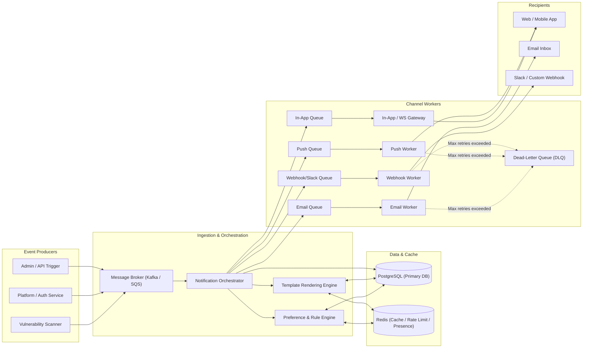
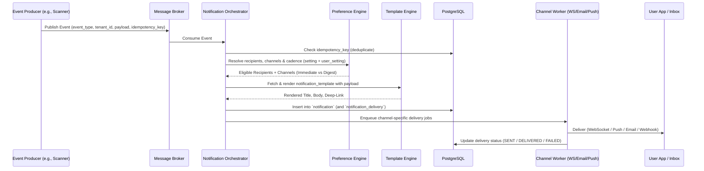
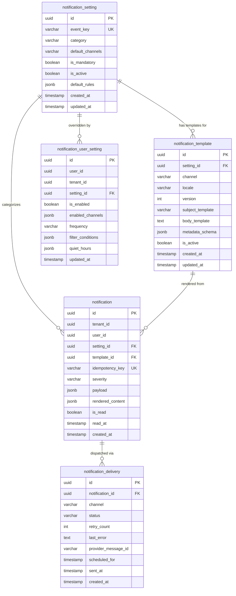
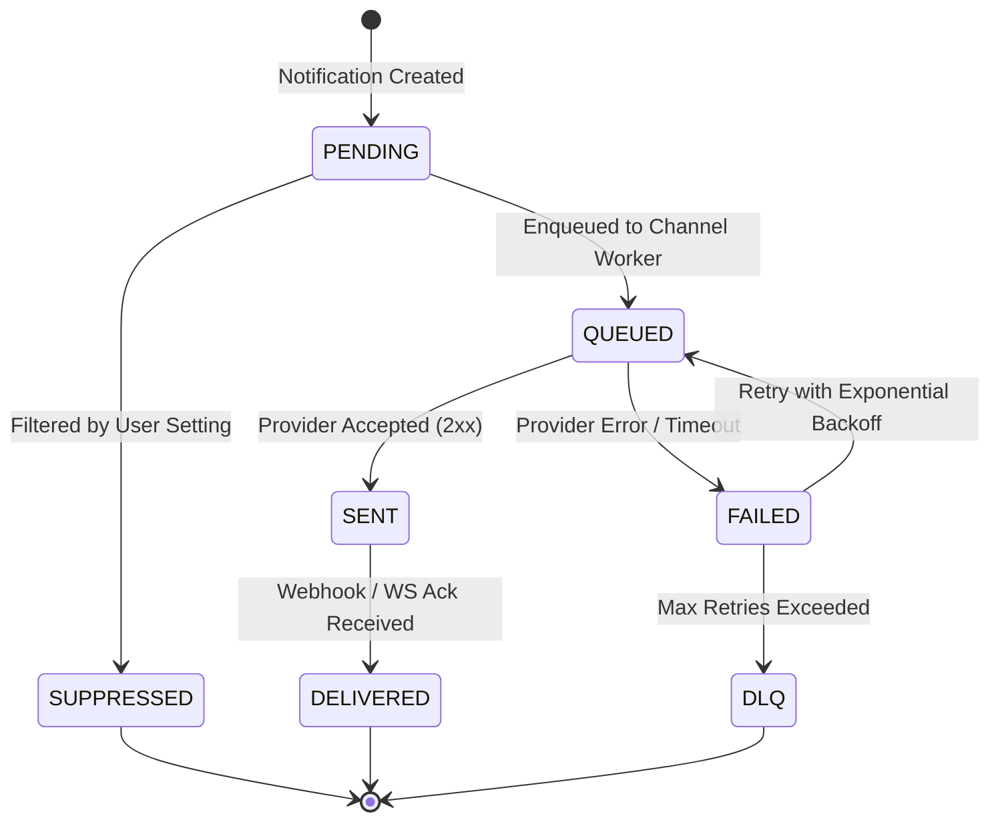

# Platform & App Notification System — HLD, LLD & Database Design

This document provides a production-ready **High-Level Design (HLD)**, **Low-Level Design (LLD)**, and **Database Design** for a multi-channel Platform & App Notification system (supporting in-app, push, email, and webhook/chat alerts such as vulnerability findings).

---

## 1. High-Level Design (HLD)

### 1.1 Architectural Goals
- **Decoupled & Event-Driven:** Producers (e.g., Vulnerability Scanner, Scan Engine, Billing, Auth) emit events without knowing *who* gets notified or *how*.
- **Multi-Channel Delivery:** Supports In-App (real-time WebSocket/SSE + bell feed), Push (FCM/APNs), Email (SES/SendGrid), and Integrations (Slack/Webhook).
- **Preference-Aware & Noise-Controlled:** Respects both platform/org-level rules (`notification_setting`) and user-level rules (`notification_user_setting`), including severity filters (e.g., *"only when a vulnerability is found"*) and digest/frequency controls.
- **Reliable & Idempotent:** At-least-once delivery with deduplication, retries with exponential backoff, and a Dead-Letter Queue (DLQ).

### 1.2 System Architecture Diagram

### 1.3 End-to-End Request Flow

---

## 2. Database Design

Building directly on your 4 core tables—`notification`, `notification_setting`, `notification_template`, and `notification_user_setting`—below is the normalized, production-ready schema.

> [!TIP]
> **Why add one optional 5th table (`notification_delivery`)?**
> A single `notification` (e.g., *"Critical Vulnerability Found"*) may be sent across **3 channels** (In-App, Email, Slack) with independent retry counts and statuses. Tracking delivery state per channel in `notification_delivery` keeps the `notification` table clean and fast for the user's in-app inbox.

### 2.1 Entity-Relationship (ER) Diagram

---

### 2.2 Table Specifications

#### 1. `notification_setting` (Platform / System-Level Configuration)
Defines **what** notification types exist, **when** they trigger, and **how** they are sent by default.

| Column | Type | Constraints | Description |
| :--- | :--- | :--- | :--- |
| `id` | `UUID` | `PK` | Unique setting identifier |
| `event_key` | `VARCHAR(100)` | `UNIQUE, NOT NULL` | Machine key, e.g., `vuln.critical.found`, `scan.completed`, `auth.new_login` |
| `category` | `VARCHAR(50)` | `NOT NULL` | Grouping: `SECURITY`, `SCAN`, `SYSTEM`, `BILLING` |
| `default_channels` | `JSONB` | `NOT NULL` | Default channels: `["IN_APP", "EMAIL", "PUSH"]` |
| `is_mandatory` | `BOOLEAN` | `DEFAULT false` | If `true`, users cannot mute it (e.g., security breach / password reset) |
| `is_active` | `BOOLEAN` | `DEFAULT true` | Global kill-switch for this notification type |
| `default_rules` | `JSONB` | `DEFAULT '{}'` | Default trigger/throttling rules (e.g., `{"min_severity": "HIGH", "dedupe_window_sec": 300}`) |
| `created_at` | `TIMESTAMPTZ` | `DEFAULT now()` | Creation timestamp |
| `updated_at` | `TIMESTAMPTZ` | `DEFAULT now()` | Last update timestamp |

---

#### 2. `notification_template` (Reusable API & Channel Templates)
Stores versioned templates per `setting_id`, `channel`, and `locale` (e.g., Handlebars/Mustache syntax `{{vuln_name}}`). Returned via API for preview/management and used by the rendering engine.

| Column | Type | Constraints | Description |
| :--- | :--- | :--- | :--- |
| `id` | `UUID` | `PK` | Unique template identifier |
| `setting_id` | `UUID` | `FK -> notification_setting(id)` | Links template to its event/setting |
| `channel` | `VARCHAR(30)` | `NOT NULL` | `IN_APP`, `EMAIL`, `PUSH`, `SLACK`, `WEBHOOK` |
| `locale` | `VARCHAR(10)` | `DEFAULT 'en'` | Language code (`en`, `es`, `fr`) |
| `version` | `INT` | `DEFAULT 1` | Version number for auditing & rollback |
| `subject_template` | `VARCHAR(255)` | `NULLABLE` | Title or email subject (e.g., `"[{{severity}}] Vulnerability found in {{asset}}"`) |
| `body_template` | `TEXT` | `NOT NULL` | Body with placeholders (HTML/Markdown/Plain text depending on channel) |
| `action_url_template` | `VARCHAR(500)` | `NULLABLE` | Deep-link template (e.g., `"/scans/{{scan_id}}/vulns/{{vuln_id}}"`) |
| `is_active` | `BOOLEAN` | `DEFAULT true` | Only one active template per `(setting_id, channel, locale)` |
| `created_at` | `TIMESTAMPTZ` | `DEFAULT now()` | Creation timestamp |
| `updated_at` | `TIMESTAMPTZ` | `DEFAULT now()` | Last update timestamp |

---

#### 3. `notification_user_setting` (User-Level Preferences & Conditions)
Controls **how often**, **on which channels**, and **under what conditions** a specific user wants notifications (e.g., *"only when a vulnerability is found"* or *"daily digest"*).

| Column | Type | Constraints | Description |
| :--- | :--- | :--- | :--- |
| `id` | `UUID` | `PK` | Unique user preference ID |
| `user_id` | `UUID` | `NOT NULL` | Target user |
| `tenant_id` | `UUID` | `NOT NULL` | Organization/workspace scope |
| `setting_id` | `UUID` | `FK -> notification_setting(id)` | The notification type being customized |
| `is_enabled` | `BOOLEAN` | `DEFAULT true` | User opt-in / opt-out (ignored if `is_mandatory = true`) |
| `enabled_channels` | `JSONB` | `NOT NULL` | User's chosen channels: `["IN_APP", "EMAIL"]` |
| `frequency` | `VARCHAR(20)` | `DEFAULT 'IMMEDIATE'` | `IMMEDIATE`, `HOURLY_DIGEST`, `DAILY_DIGEST`, `WEEKLY_DIGEST` |
| `filter_conditions` | `JSONB` | `DEFAULT '{}'` | Custom rules, e.g., `{"only_if_vuln_found": true, "min_severity": "HIGH"}` |
| `quiet_hours` | `JSONB` | `NULLABLE` | Do-Not-Disturb window: `{"start": "22:00", "end": "07:00", "tz": "Asia/Kolkata"}` |
| `updated_at` | `TIMESTAMPTZ` | `DEFAULT now()` | Last update timestamp |

*Unique Constraint:* `UNIQUE (tenant_id, user_id, setting_id)`

---

#### 4. `notification` (Core Notification Record / In-App Inbox)
Stores each generated notification instance, its raw `payload`, and its rendered snapshot for fast in-app retrieval.

| Column | Type | Constraints | Description |
| :--- | :--- | :--- | :--- |
| `id` | `UUID` | `PK` | Unique notification ID |
| `tenant_id` | `UUID` | `NOT NULL` | Workspace/org isolation |
| `user_id` | `UUID` | `NOT NULL` | Recipient user |
| `setting_id` | `UUID` | `FK -> notification_setting(id)` | Notification type |
| `template_id` | `UUID` | `FK -> notification_template(id)` | Template version used |
| `idempotency_key` | `VARCHAR(128)` | `UNIQUE` | Prevents duplicate notifications on retries |
| `severity` | `VARCHAR(20)` | `DEFAULT 'INFO'` | `INFO`, `LOW`, `MEDIUM`, `HIGH`, `CRITICAL` |
| `payload` | `JSONB` | `NOT NULL` | Raw event data (e.g., `{"scan_id": "...", "vuln_count": 3, "cve": "CVE-..."}`) |
| `rendered_content` | `JSONB` | `NOT NULL` | Pre-rendered `{ "title": "...", "body": "...", "action_url": "..." }` |
| `is_read` | `BOOLEAN` | `DEFAULT false` | Read status for in-app bell badge |
| `read_at` | `TIMESTAMPTZ` | `NULLABLE` | Timestamp when user read it |
| `created_at` | `TIMESTAMPTZ` | `DEFAULT now()` | Creation timestamp |

---

#### 5. `notification_delivery` (Optional / Recommended — Per-Channel Tracking)
Tracks delivery attempts, retries, and digest scheduling independently per channel.

| Column | Type | Constraints | Description |
| :--- | :--- | :--- | :--- |
| `id` | `UUID` | `PK` | Delivery record ID |
| `notification_id` | `UUID` | `FK -> notification(id)` | Parent notification |
| `channel` | `VARCHAR(30)` | `NOT NULL` | `IN_APP`, `EMAIL`, `PUSH`, `SLACK`, `WEBHOOK` |
| `status` | `VARCHAR(20)` | `NOT NULL` | `PENDING`, `QUEUED`, `SENT`, `DELIVERED`, `FAILED`, `SUPPRESSED` |
| `retry_count` | `INT` | `DEFAULT 0` | Number of delivery attempts |
| `last_error` | `TEXT` | `NULLABLE` | Error message from provider if failed |
| `scheduled_for` | `TIMESTAMPTZ` | `NULLABLE` | Used for Quiet Hours deferral or Digest batching |
| `sent_at` | `TIMESTAMPTZ` | `NULLABLE` | Provider acceptance timestamp |

---

### 2.3 Indexing & Partitioning Strategy
- **In-App Inbox Query (Most Frequent):**
  - Composite index on `notification (tenant_id, user_id, created_at DESC)` for paginated feed.
  - Partial index on `notification (tenant_id, user_id) WHERE is_read = false` for instant unread badge count.
- **Preference Lookup:**
  - Unique index on `notification_user_setting (tenant_id, user_id, setting_id)` + Redis read-through cache (TTL 5–15 min, invalidated on update).
- **Template Lookup:**
  - Unique partial index on `notification_template (setting_id, channel, locale) WHERE is_active = true`.
- **Partitioning & Retention:**
  - Range-partition `notification` and `notification_delivery` monthly by `created_at`.
  - Archive or drop partitions older than 90–180 days to keep table sizes small and indexes hot.

---

## 3. Low-Level Design (LLD)

### 3.1 Core Internal Modules

1. **Event Ingestion & Deduplication Module**
   - Validates incoming event schema against `notification_setting.event_key`.
   - Computes or reads `idempotency_key` (e.g., `hash(event_key + entity_id + user_id + time_bucket)`).
   - Uses Redis `SETNX` (short TTL) + DB unique constraint to guarantee no duplicate alerts.

2. **Preference & Condition Evaluation Engine**
   - Resolution hierarchy:
     1. Check `notification_setting.is_active`. If `false`, drop event.
     2. If `notification_setting.is_mandatory == true`, force delivery on `default_channels`.
     3. Otherwise, load `notification_user_setting` (fallback to `notification_setting` defaults if user hasn't customized).
     4. Evaluate `filter_conditions` against event `payload`:
        - Example: User set `{"only_if_vuln_found": true}` → if `payload.vuln_count == 0`, mark as `SUPPRESSED` and skip.
        - Example: User set `{"min_severity": "HIGH"}` → if `payload.severity == "LOW"`, suppress.
     5. Check `quiet_hours` and `frequency`:
        - If `IMMEDIATE` and outside quiet hours → enqueue immediately.
        - If inside quiet hours → set `scheduled_for = quiet_hours.end`.
        - If `DAILY_DIGEST` / `HOURLY_DIGEST` → hold in digest batch until the scheduled cron window.

3. **Template Rendering Engine**
   - Loads active `notification_template` for `(setting_id, channel, user_locale)` from Redis/DB.
   - Injects `payload` variables using a safe, logic-less template engine (e.g., Handlebars/Mustache) with strict HTML escaping for email/web to prevent XSS.
   - Stores the rendered output in `notification.rendered_content` so future template edits don't mutate historical notifications.

4. **Channel Dispatchers & Retry State Machine**

---

### 3.2 REST & Real-Time API Contracts

#### In-App Notification APIs (Client-Facing)
| Method | Endpoint | Purpose |
| :--- | :--- | :--- |
| `GET` | `/api/v1/notifications?cursor=&limit=20&unread_only=true` | Cursor-paginated notification feed |
| `GET` | `/api/v1/notifications/unread-count` | Fast badge count for app header |
| `PATCH` | `/api/v1/notifications/{id}/read` | Mark single notification as read |
| `PATCH` | `/api/v1/notifications/read-all` | Mark all notifications as read |
| `WS/SSE` | `/ws/v1/notifications` | Real-time push to active web/mobile sessions |

#### User Settings APIs
| Method | Endpoint | Purpose |
| :--- | :--- | :--- |
| `GET` | `/api/v1/notification-settings/me` | Returns merged `notification_setting` + `notification_user_setting` |
| `PUT` | `/api/v1/notification-settings/me/{setting_id}` | Update `is_enabled`, `enabled_channels`, `frequency`, `filter_conditions`, `quiet_hours` |

#### Template & Platform Settings APIs (Admin / Internal)
| Method | Endpoint | Purpose |
| :--- | :--- | :--- |
| `GET` | `/api/v1/admin/notification-templates?setting_id=&channel=` | List/fetch templates |
| `POST` | `/api/v1/admin/notification-templates` | Create new template version |
| `POST` | `/api/v1/admin/notification-templates/{id}/preview` | Render template with sample `payload` |
| `POST` | `/api/v1/internal/notifications/dispatch` | Internal API (or Kafka event) to trigger a notification |

---

### 3.3 Key Design Decisions & Edge Cases
- **Real-Time Presence Optimization:** Before sending a mobile Push or Email for an alert, check Redis presence (`user:online:{user_id}`). Optionally delay email by 2 minutes if the user is actively viewing the app and already saw the in-app notification.
- **Digest Aggregation:** A scheduled Digest Worker queries `notification_delivery` where `status = 'PENDING'` and `scheduled_for <= now()`, groups them by `(user_id, channel)`, renders a digest template (e.g., *"You have 5 new vulnerabilities across 2 scans"*), and sends a single consolidated email/message.
- **Rate Limiting / Storm Protection:** If a scan discovers 500 vulnerabilities in 10 seconds, apply a sliding-window throttle per `(tenant_id, user_id, event_key)` in Redis to collapse bursts into a single summary notification.
